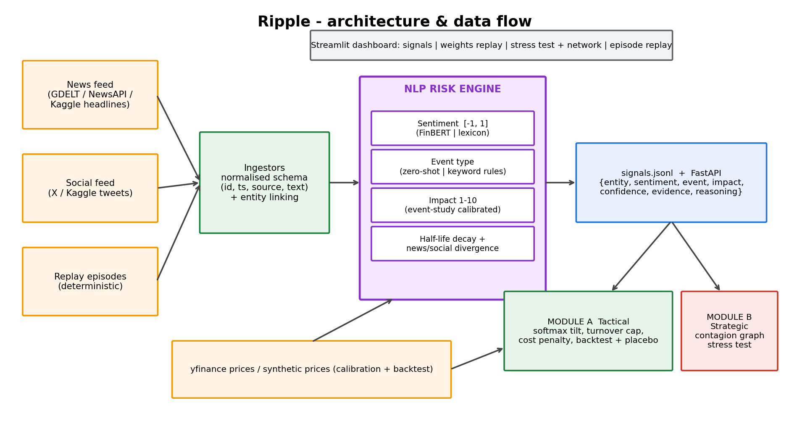

# SignalForge: A Single Text-Intelligence Engine Powering Fast and Slow Risk Decisions - S&P Global & Crisil Campus Hackathon

## 1. Project Overview / Problem Statement & Approach

Markets react to headlines and social chatter within minutes, while risk teams still read most of it by hand. SignalForge closes that gap with one **AI/NLP risk engine** that reads text from two separate channels (news and social posts) and turns each item into a structured signal: a **sentiment score from -1 to 1**, an **event category**, and an **impact rating from 1 to 10**. Every signal also includes a confidence value, the sentence it was based on and the key terms behind the decision. Results are saved to `data/signals.jsonl` and exposed through a FastAPI service.

To show the engine is reusable, two downstream applications are built on it. **Module A** adjusts the weights of a mock stock index as sentiment changes and is backtested. **Module B** stress-tests a synthetic wholesale-banking portfolio (loans, bonds and derivatives) whenever a severe event is detected.

Distinguishing features:
1. **Impact learned from data** - an event study records how far stocks move abnormally in the 3 days after each type of event, and that move is converted to a 1-10 rating (`data/impact_calibration.csv`). A prior value fills in when there are too few observations.
2. **Fading sentiment** - every event type has its own half-life (3 days for earnings, 10 for geopolitics), so index weights ease back toward neutral instead of jumping around.
3. **News/social gap detection** - if social media is much gloomier than the news, the engine raises a possible-rumour or early-warning flag.
4. **Transparent outputs** - evidence, confidence and reasoning accompany each JSON record.
5. **Contagion graph (Module B)** - shocks travel from event to sector or country, then to counterparty and finally to individual assets, and each instrument type is revalued with its own formula instead of one uniform shock.
6. **Replay mode** - weights and two crisis-style episodes can be replayed deterministically, so the demo does not depend on live news.
7. **Candid backtesting** - results are compared with benchmarks after trading costs and checked against a placebo test with shuffled signals.

## 2. Architecture & Tech Stack



```
news / social / replay CSVs -> ingestors (common schema) -> entity linking
  -> NLP risk engine: sentiment | event type | calibrated impact | decay + divergence
  -> data/signals.jsonl + FastAPI
       -> Module A: exponential tilt, 2-15% weight limits, 10% turnover cap, 10 bps cost, backtest
       -> Module B: contagion graph; loans via PD/LGD, bonds via duration/convexity, derivatives via delta + CVA
  -> Streamlit dashboard (weight replay, stress test, network view, episode replay)
```

Built with Python 3.10+, pandas, numpy, networkx, matplotlib, FastAPI, Streamlit and Plotly. The NLP layer has two interchangeable back-ends: an offline **lexicon** model (default, deterministic) and **FinBERT + BART-MNLI zero-shot** (`--model transformer`, requires `transformers` and `torch`).

## 3. Dataset Used

Everything included is **synthetic**, produced by `src/data_gen.py` with seed 42, and stored in `/data`:

| File | Content |
|---|---|
| `news.csv`, `tweets.csv` | templated headlines and posts about 14 large-cap tickers over ~120 trading days from 2 sources, including social-only "rumour" bursts |
| `prices.csv` | synthetic daily closing prices (market factor + noise + post-event shocks) |
| `portfolio.csv` | 90 synthetic assets (40 loans, 30 bonds, 20 derivatives) across 30 counterparties, 8 sectors and 10 countries |
| `replay_episodes.csv` | brief hand-written headlines inspired by a banking-run and a geopolitical-shock episode (illustrative, not scraped) |
| `signals.jsonl`, `impact_calibration.csv` | outputs generated by the engine |

Key caveats:
- The generator places price shocks after events, so Module A's strong result is a product of the generator and shows the pipeline working end to end, **not** genuine alpha. The dashboard includes a placebo test and a warning to this effect.
- Text is templated and the keyword rules come from the same author, so classification accuracy here is flattering. The FinBERT/zero-shot back-end is included for that reason.
- For real data: `pip install yfinance && python -m src.fetch_real_data`, and place GDELT, NewsAPI or Kaggle exports in `data/news.csv` and `data/tweets.csv` (columns `id,timestamp,source,text`). No proprietary or confidential data is used.
- Stress-test shocks and vulnerability matrices are illustrative assumptions, not calibrated regulatory scenarios.

## 4. Quickstart & Installation

Runtime: Python 3.10+ (tested on 3.12), Linux.

```bash
git clone https://github.com/Veedushi2101/hackathon_naukri
cd hackathon_naukri
pip install -r requirements.txt
python run_all.py                      # engine + Module A backtest + Module B stress + replays (~20 s)
python -m src.make_docs                # optional: rebuild docs/presentation.pdf and architecture.png
streamlit run src/dashboard.py         # interactive dashboard
uvicorn src.api:app --reload           # API: /signals /analyze /stress  (docs at /docs)
python tests/test_core.py              # unit tests (or: python -m pytest -q)
```
Flags: `python run_all.py --regen` rebuilds the synthetic data; `--model transformer` uses FinBERT and zero-shot classification.

## 5. Key Results & Domain Impact

Engine: 1,048 signals from 2 sources; 165 with impact of 7 or more; 41 ticker-days flagged for news/social divergence.

Learned impact ratings (average absolute abnormal return over t+1 to t+3, converted to a score): Credit 8.5, M&A 8.4, Geopolitical 7.8, Earnings 7.2, Regulatory 6.2, Macro 6.1, Product 5.3.

**Module A** (synthetic prices, after 10 bps costs):

| | Return | Sharpe | Max DD | Daily turnover |
|---|---|---|---|---|
| SignalForge sentiment-tilt | 23.5% | 3.12 | -2.9% | 5.9% |
| Equal-weight | -4.0% | -0.54 | -6.7% | - |
| Buy & hold | -3.2% | -0.41 | -6.2% | - |

Note again: this reflects how the synthetic data was built (Section 3), not a tradable edge.

**Module B**: any signal with impact of 7 or higher and negative sentiment launches a stress test (Credit, Geopolitical, M&A and Earnings in the demo). The portfolio falls from 2,566m to 2,285m (-10.9%), against only -114m under a naive flat shock that also cannot show where losses concentrate. The banking-run replay loses 5.5% and the geopolitical replay 5.2%, each triggered at impact 8.

Why it matters: risk teams receive auditable, machine-readable early warnings; impact scores rest on measured market behaviour; and stress tests follow genuine exposure routes (sector, country, counterparty).

Limitations and next steps: use real GDELT/NewsAPI streams and real prices, calibrate spill-overs on historical crises, add per-counterparty ratings and multi-hop contagion, and monitor model drift.

## Repository layout
```
run_all.py            one-command pipeline
src/data_gen.py       synthetic data        src/config.py   universe, taxonomy, half-lives
src/engine/           nlp.py, impact.py, engine.py (the risk engine)
src/modules/          rebalancer.py (A), stress.py (B)
src/api.py            FastAPI               src/dashboard.py  Streamlit
src/make_docs.py      deck + diagram        src/fetch_real_data.py  optional yfinance loader
data/  results/  docs/  tests/
```
